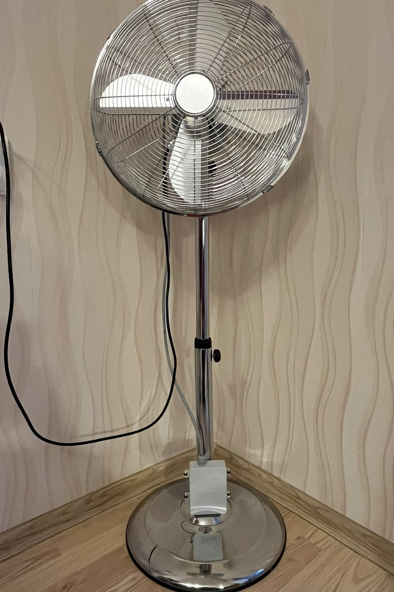
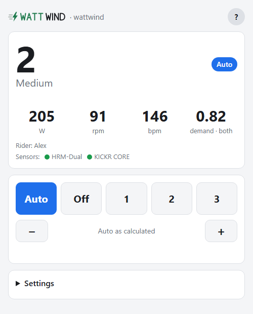

# WattWind: a fan that knows how hard you're riding

An automatic fan for indoor cycling. A small box with a Raspberry Pi Pico 2 W listens to the heart-rate strap and smart
trainer you already ride with (Bluetooth) and switches your own 3-speed floor fan through relays: off in the warm-up,
full blast in the intervals, and winding down to off when you stop pedaling. Your phone is the remote: the fan serves
its own web page, with no app, no account and no cloud.

  
  

**Project site: <https://wattwind.github.io/wattwind/>**: what it does, [try the page](https://wattwind.github.io/wattwind/demo.html) (a demo in your browser), [all features](https://wattwind.github.io/wattwind/features.html),
the [user manual](https://wattwind.github.io/wattwind/help.html) and the
[build guide](https://wattwind.github.io/wattwind/build.html).

> [!WARNING]
> **This project switches mains voltage (230 V).** Mains can kill. Build it only if you are competent with mains
> wiring, never work on it plugged in, and use an RCD-protected outlet. It is a prototype shared as a hobby project,
> not a certified product: you build and use it at your own risk. Read
> [Safety](https://wattwind.github.io/wattwind/#safety) first.

## What it does

- **Auto:** follows your power (against your FTP), your heart rate (within your own range) or both, up quickly and
  down slowly, one level at a time. Stop pedaling and it winds down by itself.
- **Also an ordinary fan:** Off · 1 · 2 · 3 from the page, an off timer, and it returns to Auto (and off) when forgotten.
- **Several riders, several fans:** up to five rider profiles that switch by whose strap is worn; any number of
  linked fans following one leader over Wi-Fi.
- **Careful by design:** relays off at every start, a hardware watchdog, both mains wires cut when off, an interlock
  that can't power two speeds at once; own Wi-Fi password and PIN at setup, signed firmware updates over Wi-Fi.

## Building one

Everything is in the [build guide](https://wattwind.github.io/wattwind/build.html). In short:

1. Order the PCB (the Gerber ZIP from the [latest release](https://github.com/wattwind/wattwind/releases/latest)) and
   solder 16 through-hole parts (about €70–80 in parts).
2. Copy the project's MicroPython file onto the Pico (from the release: stock MicroPython allows only one Bluetooth
   connection, the fan needs two or three; [why](micropython/README.md)).
3. Copy the `firmware/` folder onto the Pico with Thonny; a relay test clicks through every level.
4. Print the box (print files in the release, or generate them from the Fusion script).
5. Replace the fan's speed switch with a cable to the box.
6. Join the fan's Wi-Fi, choose your own password and PIN, enter your FTP and heart-rate range, ride.

Later firmware updates go over Wi-Fi from the fan's page. To hear about new versions: **Watch → Custom → Releases**
on this page, or **Check for updates** on the fan.

## What's in this repository

| Folder or file | What's in it |
|---|---|
| [`firmware/`](firmware/) | The fan's program (MicroPython) and its web page; [how it works](firmware/README.md) and its tests |
| [`hardware/`](hardware/) | The relay board (KiCad 10) and its [design notes](hardware/DESIGN.md), [parts list](hardware/docs/bom.md) and [prices](hardware/docs/prices.md); the enclosure and cable-entry Fusion scripts |
| [`micropython/`](micropython/) | The patch and build script for the custom MicroPython file, and the licences of what's inside it |
| [`docs/`](docs/) | The project site (GitHub Pages), the user manual and the page demo |
| [`tools/`](tools/) | Release and documentation tools (manifest, signed update file, signing keys, charts, renders) |
| [`CHANGELOG.md`](CHANGELOG.md) | What changed in each release, and whether builders need to do anything |
| [`SECURITY.md`](SECURITY.md) | How to report a security problem |
| [`SECURITY-CHECK.md`](SECURITY-CHECK.md) | The design checked point by point against ETSI EN 303 645 (as a guide, not a certification) |
| [`LICENSE.md`](LICENSE.md) | Which licence covers what |

## Licences

Firmware and tools: MIT. Hardware and mechanical designs: CERN-OHL-P v2. Site, docs and the project's own images:
CC BY 4.0. Third-party code and the custom MicroPython file's drivers keep their own licences. Details:
[LICENSE.md](LICENSE.md).

Provided as is, without warranty of any kind. Designed with AI assistance; built, measured and tested by the author.
