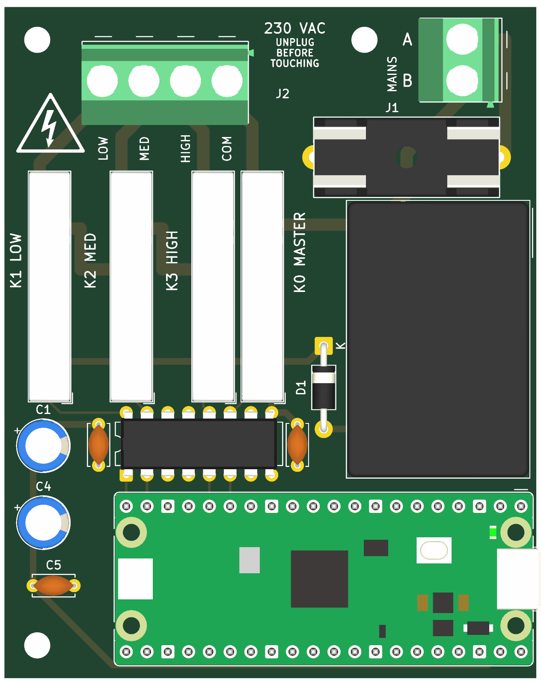

# WattWind relay board v3.1

v3.1 (2026-10-30) is v3.0 with a new back silkscreen only (WattWind logo and name, rev 3.1 title
blocks): same copper, parts and holes, so a v3.0 board is electrically the same.

KiCad 10 project for the relay board: 65 × 82 mm, 2 layers, all through-hole. Four Finder 34.51
relays, a Mean Well IRM-02-5, a TBD62003A driver and a Raspberry Pi Pico 2 W (soldered on its pin headers).
Earlier prototypes (v1.0 with Omron relays, v2.0 with 3.5 mm terminals) are not published; `DESIGN.md` says what
changed and why.



## Terminals J1 / J2: any 5.0 or 5.08 mm single-row part

The mains input (J1, 2-pole) and fan output (J2, 4-pole) take any common 5.0 mm or 5.08 mm
PCB terminal block. The pads sit at **5.04 mm**, halfway between the two standards: the outer pin
of a 4-pole part is at most 0.12 mm off, inside the play of the 1.3 mm holes. Oval 1.8 × 3.0 mm
pads leave 3.24 mm between neighbouring mains pads.

| Part (2-pole / 4-pole) | Connection | Notes |
|---|---|---|
| **Phoenix Contact MKDS 1,5/2-5,08 (1715721) / MKDS 1,5/4-5,08 (1715747)** | screw | default in the schematic; hole 1.3 mm; 250 V (III/3) / 400 V (III/2); stocked by all major distributors |
| Phoenix Contact PT 1,5/2-5,0-H (1935161) / PT 1,5/4-5,0-H (1935187) | screw (M2.6, 0.35–0.4 Nm, per the Phoenix catalog) | hole 1.3 mm; pin 1.0 mm |
| WAGO 236-102 / 236-104 | spring (CAGE CLAMP), 45° | "5/5.08 mm"; 1.3 mm hole is loose but solderable |
| WAGO 250-502 / 250-504 | spring (push-in CAGE CLAMP, push-button), 45° | 5.0 mm; 0.75–1.5 mm² stranded wire, no ferrule needed; 320 V (III/3), 17.5 A; pin 0.5 × 0.75 mm is loose in the 1.3 mm hole: hold the part flat while soldering; 16.5 mm tall; body reaches 8.3 mm behind the pin row (DRC-checked: J1 clears H1) |
| Generic 5.0 mm screw terminals (Degson DG301-5.0, "KF301-5.0") | screw | cheapest; check the voltage rating, quality varies |
| Metz Connect, Altech AK300, RND 205-000xx, Würth WR-TBL 5.0/5.08 | screw | check the hole size (1.1–1.4 mm) |

Not compatible: CUI TB007-508 (needs a 1.6 mm hole), parts with two pins per pole or staggered pins.
The wire side faces the board edge (J2: top edge, J1: right edge).

J2 pins left to right on the board: **LOW, MED, HIGH, COM** (pin 1 = COM). J1: **A** (top), **B**.

### Wiring the terminals

Fan and mains cords are usually stranded wire (0.75 mm²). Whichever terminal you choose:

- **Screw terminals: crimp a ferrule on every wire** (0.75 mm², insulated). Bare strands splay
  under the screw and settle over time, and the joint works loose. Never tin the wire ends:
  solder creeps under the clamping pressure and the joint loosens the same way.
- **WAGO 236 (spring clamp):** bare stranded wire is fine. Open the clamp with a screwdriver or
  the WAGO operating tool. Check that the 45° wire entry clears the enclosure lid.
- **WAGO 250-5xx (push-in, push-button):** press the button while inserting bare stranded wire;
  solid wire or ferrules push straight in. Strip 9–10 mm. Check that the 45° wire entry clears
  the enclosure lid.
- Strip only as much as the terminal's datasheet says. No copper should show outside the terminal.
- Give each wire a firm pull test after clamping.
- **Strain relief on the cable at the enclosure wall** (cable gland or clamp). A tug on the cable
  must never reach the terminal. This matters more than which terminal type you pick.

## Before ordering

- The release has the Gerber ZIP ready (`wattwind-v3.1-gerbers.zip`): any PCB maker, default options (2 layers,
  1.6 mm, 1 oz copper). Make your own only after changing the board.
- Check the pin size of the terminals you buy against the 1.3 mm holes, and their 230 VAC rating.
- The enclosure script in `enclosure/` is made for this board and checked in Fusion (no part touches the base or lid).

## Checking the board and making the Gerbers (KiCad 10)

Open `wattwind.kicad_pro` in KiCad 10 to look at or change the board. From the command line (`kicad-cli` comes with
KiCad; on Windows it is in `C:\Program Files\KiCad\10.0\bin\`), run from this folder:

```bash
# ERC: expected 4 findings, all excluded with a comment (see DESIGN.md)
kicad-cli sch erc --severity-all --exit-code-violations -o erc.rpt wattwind.kicad_sch

# DRC: expected 0 violations, 3 commented exclusions. --all-track-errors lists every violation, not one per track
kicad-cli pcb drc --schematic-parity --all-track-errors --refill-zones --severity-all \
    --exit-code-violations -o drc.rpt wattwind.kicad_pcb

# Gerbers (2 layers) and Excellon drill files, then zip production/gerbers/* for the PCB maker
mkdir -p production/gerbers
kicad-cli pcb export gerbers --check-zones --subtract-soldermask \
    -l F.Cu,B.Cu,F.SilkS,B.SilkS,F.Mask,B.Mask,Edge.Cuts -o production/gerbers/ wattwind.kicad_pcb
kicad-cli pcb export drill --format excellon --excellon-units mm --excellon-separate-th \
    --generate-map --map-format gerberx2 -o production/gerbers/ wattwind.kicad_pcb

# The board's 3D model, which the enclosure script loads for its fit check
kicad-cli pcb export step --subst-models --user-origin "172.5x125mm" -o production/wattwind.step wattwind.kicad_pcb

# Parts list
kicad-cli sch export bom -o production/bom.csv wattwind.kicad_sch
```

`production/` is git-ignored except `wattwind.step`. The project footprints for J1 / J2 are made by
`tools/make_terminal_footprints.py` (`WattWind.pretty/`); the relays use KiCad's footprint with a white 3D model
(`3dmodels/`).

More detail: `DESIGN.md` (decisions and why), `docs/bom.md` (parts), `docs/prices.md` (what it costs, where to buy),
`docs/netlist.md` (every pin), `docs/placement.md` (layout).
